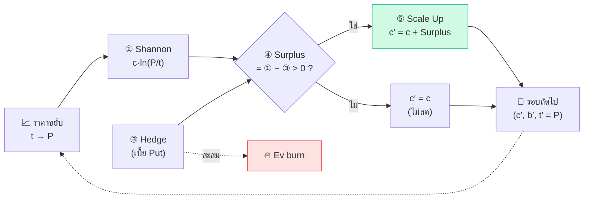
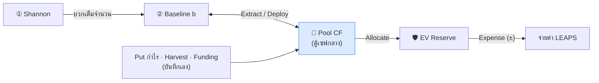

# ⚡ Chain System — Main Engine v2 · อ่านง่ายๆ

> **30 วินาที:** เครื่องคิดเลข + สมุดบัญชีสำหรับพอร์ตแบบ **"ถือมูลค่าคงที่ + ซื้อประกัน (Put)"**
> เอา **กำไรจากความแกว่งของราคา → จ่ายค่าประกัน → ที่เหลือไปขยายทุนรอบหน้า** วนเป็นลูกโซ่ (Chain)
> v2 = หน้าใหม่ที่ **ง่าย · นิ่ง · เร็ว · ทันสมัย** กว่าเดิม — สูตรเดิม ข้อมูลชุดเดิม (`trading_data.json`)
> ทันสมัย = มี **🧬 Ledger** (สมการ `Rₙ · ΔAₙ · Aₙ · Eₙ` ตาม [streamlit_lego](https://github.com/firstnattapon/streamlit_lego) + ชี้เมาส์ดูที่มาของทุกตัวเลข) และ **🎓 Learn** (สมการ · แผนภาพ · Testing Lab)
> 🗺️ **แผนผังทั้งระบบ + หลักการ + เป้าหมายสูงสุด** เป็น flowchart ตัวเดียว: [`app_v2_system.mmd`](app_v2_system.mmd) (วางที่ [mermaid.live](https://mermaid.live) ได้เลย) · แบบเล็กสุด 5 ขั้นที่ไปถึงเป้าหมายเดิม: [`app_v2_minimal.mmd`](app_v2_minimal.mmd)

---

## 🎯 1. มันคืออะไร

**คิดง่ายๆ:** ร้านค้าที่ต้องจ่ายค่าประกันร้านทุกรอบ — กำไรจากการซื้อมาขายไปต้องมากพอจ่ายเบี้ยก่อน ถ้ามีเหลือ ค่อยเอาไปขยายร้าน

| | ทำอะไร | อยู่ที่ไหนใน v2 |
|---|---|---|
| 🧮 **คำนวณ** | 1 รอบ: ราคาขยับ → ได้/เสียเท่าไร → จ่ายประกันเท่าไร → เหลือเท่าไร | ⚡ Engine |
| 📒 **จดบัญชี** | ต่อ ticker: `fix_c` · Baseline · Ev burn — และเงินกลาง: Pool CF · EV Reserve | 🧬 Ledger · 🏛️ Treasury |
| 🧬 **อ่านกำไรจริง** | `Rₙ · Aₙ · Eₙ` ทุกรอบ + ชี้เมาส์ดูสูตรแทนค่าจริง + ตรวจสมการ (Integrity) | 🧬 Ledger · 🎓 Learn |
| 🩺 **วัดสุขภาพ** | กำไรชนะค่าประกันหรือยัง (Ev Efficiency) | 📊 Portfolio |

**ใช้งานจริง 3 ขั้น:** ① เลือก ticker → ใส่ **P New** (หรือกด 🔄 Yahoo) → ② ดูผล (ถ้าของจริงต่างจากสูตร ใช้ ✏️ **Override**) → ③ ✅ **Commit**

> 🔗 ลิงก์ตรงได้: `/app-v2?view=ledger&ticker=LUNR` — เลือก view/ticker แล้วรีเฟรชหน้า ก็ยังอยู่ที่เดิม

> [!NOTE]
> **ไม่ใช่บอทเทรด** — ไม่ส่งออเดอร์ และไม่ใช้ DNA คุณเทรดจริงที่ broker แล้วมาคำนวณ/บันทึกที่นี่
> (แต่ใช้สมการ Shannon ตัวเดียวกับในบอท: `fix_c · ln(P/p₀)`)

---

## ❓ 2. ทำไปทำไม

**ปัญหา:** Shannon's Demon เก็บกำไรจากความแกว่งได้ แต่ขาลงเจ็บกว่าขาขึ้น (ดู `ln` ด้านล่าง) จึงต้องซื้อประกัน — ประกันมีต้นทุน (**Ev burn**) — และเงินก็กระจายหลายก้อน จนไม่รู้ว่า *ได้เท่าไร จ่ายเท่าไร เหลือไปไหน*

**คำตอบ:** ผูกทุกอย่างเป็นห่วงโซ่เดียว ทุกบาทมี "เลน" ชัดเจน และทุกรอบมีคำถามเดียว → **กำไรชนะค่าประกันไหม?**

### 🆚 แล้วทำไมต้อง v2

| หน้าเดิม | v2 |
|---|---|
| ทุก tab รันใหม่ทุกครั้งที่กดอะไรก็ตาม (≈ 367 ms) | รันเฉพาะ view ที่เปิด (⚡ Engine ≈ 61 ms · เร็วกว่า ~6 เท่า · view ที่หนักสุดคือ 🎓 Learn ≈ 221 ms ก็ยังเร็วกว่าเดิม) |
| Preview ค้าง → Commit ทับ Baseline ที่เพิ่งเปลี่ยน | ปุ่ม Commit ผูกกับ "แผน" — แผนเก่ากดไม่ติด |
| ไฟล์เสีย → เริ่มพอร์ตว่างแล้วเขียนทับ | ใช้ backup · ไม่เขียนทับจนกว่าจะ Import |
| จ่าย Hedge แล้ว Net P&L ไม่ลด | Commit แล้ว Net P&L ลดตามเบี้ยที่จ่าย |
| "ลบทั้งหมด" คลิกเดียว | ต้องพิมพ์ `DELETE` · Restore ย้อนกลับได้ |

*(ความเร็ว: มัธยฐานของการรันซ้ำ 15 ครั้ง วัดฝั่งเซิร์ฟเวอร์ด้วย Streamlit AppTest บนพอร์ตตัวอย่าง 16 ticker — ตัวเลขสัมบูรณ์ขึ้นกับเครื่อง ดูอัตราส่วนเป็นหลัก)*

---

## 💎 3. แก่นแท่ง

> [!IMPORTANT]
> **ให้ "ความแกว่งของราคา" จ่ายค่าประกันของตัวเอง — ส่วนที่เหลือคือทุนที่โตเอง**
>
> 1. **เป้าหมาย:** กำไรจากการแกว่ง ≥ ค่าประกัน
> 2. **กติกาเดียว:** จ่ายต้นทุนก่อน เหลือเท่าไรค่อยโต → `Surplus = Shannon − Hedge`
> 3. **เงื่อนไขชี้ขาด:** ราคาต้องขยับแรงกว่าค่าเบี้ย → **ขึ้นเกิน ≈ 13% (Hedge ×1) หรือ ≈ 28% (Hedge ×2) ต่อรอบ** ถึงจะเหลือ Surplus ไปขยายทุน — ไม่ถึง = จ่ายเบี้ยฟรี (Ev burn)

---

## 🔑 4. Key Messages

| # | ข้อความ | คิดง่ายๆ |
|---|---|---|
| 1 | **กำไรคือเชื้อเพลิง ไม่ใช่ปลายทาง** — ผลรอบนี้ (`c′, b′, t′`) คือข้อมูลเข้าของรอบหน้า | เอากำไรร้านไปขยายร้านต่อ |
| 2 | **จ่ายประกันก่อน แล้วค่อยนับกำไร** | หักค่าเบี้ยก่อนแบ่งกำไร |
| 3 | **โตด้วยกำไรเท่านั้น (Free Risk)** — ทุนที่เพิ่มมาจาก Surplus ไม่ใช่เงินต้น | เล่นด้วย house money |
| 4 | **ทุกบาทมีเลน** — Baseline ⇄ Pool CF → EV Reserve → จ่าย LEAPS | แยกกระเป๋า: ลงทุน / เงินกลาง / ค่าประกัน |
| 5 | **Ev burn = ค่าเช่าเวลา** — Ev Efficiency ≥ 1 จึงเลี้ยงตัวเองได้ | ค่าเช่าร้านรายเดือน |
| 6 | **ตัวเลขในแอป = "ตามสูตร"** — ของจริงใช้ Override ให้ตรง แล้วกด Commit เอง | เครื่องคิดเลข ไม่ใช่ใบเสร็จ |

---

## 🧮 5. Key Equations

**คิดง่ายๆ:** *ได้เท่าไร → หักค่าประกัน → เหลือไปโตต่อ*

| # | สมการ | อ่านว่า |
|---|---|---|
| ⭐ 1 | `Shannon = c · ln(P / t)` | ถือมูลค่าคงที่ `c` ราคาจาก `t` → `P` ได้/เสียเท่าไร |
| 2 | `Hedge = (c / t) × Hedge× × Put(K = 0.9t)` ≈ `c × Hedge× × 12.4%` | เบี้ย Put 1 ปี OTM 10% (σ 50%, r 4%) — `Hedge×` 1 = พอดีตัว, 2 = Over-hedge |
| ⭐ 3 | `Surplus = Shannon − Hedge` | กำไรหลังจ่ายประกัน |
| ⭐ 4 | `c′ = c + max(0, Surplus)` | **Scale Up** — ทุนรอบหน้า (ติดลบ = ไม่เพิ่ม ไม่ลด) |
| 5 | `b′ = b + c·ln(P/t) − c′·ln(P/t′)` และ `t′ = P` ⇒ `b′ = b + Shannon` | **Baseline** ต่อเนื่องไม่ขาดตอนเมื่อ re-center ราคา |
| ⭐ 6 | `Surplus > 0  ⇔  ln(P/t) > 0.124 × Hedge×` | **จุดคุ้มทุน**: Hedge ×1 → ขึ้น +13.2% · ×2 → +28.1% |
| 7 | `Ev Efficiency = (Lock P&L + Surplus IV) ÷ Ev burn` | ≥ 1 ยั่งยืน · < 1 ยังเลือดไหล |

### 🧪 ตัวอย่างหนึ่งรอบ — `c = 1,000` · `t = 10` · `Hedge ×1`

```
ราคา 10 → 12:
 ① Shannon = 1,000 × ln(12/10)            = 1,000 × 0.1823     = +182.32
 ③ Hedge   = (1,000/10) × 1 × Put(10, 9)  = 100 × 1.2396       =  123.96
 ④ Surplus = 182.32 − 123.96                                    =  +58.36
 ⑤ c′      = 1,000 + 58.36                                      = 1,058.36   ← ทุนโตจากกำไรล้วนๆ
 ② b′      = 0 + 182.32                                         =  182.32
```

| ราคา 10 → | Shannon | − Hedge | = Surplus | fix_c | Baseline |
|---|---:|---:|---:|---|---|
| **12** (+20%) | +182.32 | 123.96 | **+58.36** | 1,000 → **1,058.36** | 0 → 182.32 |
| 12 แต่ Hedge ×2 | +182.32 | 247.92 | **−65.60** | 1,000 (เท่าเดิม) | 0 → 182.32 |
| **10** (นิ่ง) | 0 | 123.96 | **−123.96** | 1,000 | 0 |
| **8** (−20%) | −223.14 | 123.96 | **−347.11** | 1,000 | 0 → −223.14 |

**อ่านผล:** นิ่ง = จ่ายเบี้ยฟรี · ขึ้นแรงพอ = เหลือโต · ประกัน ×2 แพงจน +20% ยังไม่พอ · ลง = ตรงนี้แหละที่ Put ที่ซื้อไว้ต้องกำไร (คุณบันทึกเข้า Pool CF เอง — แอปไม่คำนวณกำไรของ Put ให้)

### ✅ ตรวจความสมเหตุสมผล
- `P = t` → Shannon = 0 · ราคา **ขึ้น 20% ได้ +0.182c แต่ลง 20% เสีย −0.223c** (`ln` โค้ง → ขาลงเจ็บกว่า → เหตุผลที่ต้องมีประกัน)
- **จุดคุ้มทุน +13.2% นี้อยู่ "ฐาน R"** (Shannon = ฝั่ง `ln`) — ฐาน A (เงินสดจริง `ΔA = c·m`) คือ +12.4% · ฐาน E (กำไร harvest ล้วน) ก้าวเดียวต้อง +58% / −42% → ดูหัวข้อ 7
- **จุดคุ้มทุนไม่ขึ้นกับขนาดทุน `c`** — ทั้ง Shannon และ Hedge ต่างคูณด้วย `c` ตัดกันหมด → *ทุนใหญ่ไม่ช่วยให้คุ้ม มีแต่ "ขนาดการเคลื่อนไหว" เท่านั้น*
- `0.124` มาจากค่าคงที่ของโมเดล (Put 1 ปี, OTM 10%, σ 50%, r 4%) — เบี้ยจริงต่างจากนี้ได้ → ใช้ Override
- ขอบเขต: ticker ยังไม่มีราคา (`t = 0`) หรือ `fix_c = 0` → Shannon และ Hedge = 0 (รอบนั้นใช้ตั้งราคา/เปิด position ผ่าน Override)

> [!NOTE]
> **หลักการที่ซ่อน:** *Shannon's Demon* — รักษามูลค่าคงที่ = ขายเมื่อแพงขึ้น ซื้อเมื่อถูกลง อัตโนมัติ → ได้กำไรจากความแกว่งแม้ราคาไม่มีเทรนด์ (ที่มาทางคณิตศาสตร์คืออสมการ `x − 1 ≥ ln x`) แล้ว Chain System ใส่ **"จ่ายต้นทุนก่อน"** เข้าไป → ระบบโตได้ก็ต่อเมื่อชนะต้นทุนจริง

---

## 🔗 6. การเชื่อมโยง

**ลูกโซ่ในประโยคเดียว:** ราคาแกว่ง → ได้ Shannon → หักค่า Hedge → เหลือ Surplus → ขยาย `fix_c` → รอบหน้าได้ Shannon ก้อนใหญ่ขึ้น ↻
ส่วน **เงินสด** ไหลอีกเลน: Baseline ⇄ Pool CF → EV Reserve → จ่าย LEAPS

**เลน A — ทุนโต** (คำนวณให้อัตโนมัติใน ⚡ Engine)



**เลน B — เงินสด** (คุณสั่งเองใน 🏛️ Treasury)



### 💰 เงินไปไหน

| จาก | → ไป | เรียกว่า | ทำที่ไหนใน v2 |
|---|---|---|---|
| Shannon | Baseline `b` | บวกเต็มจำนวนทุกรอบ | ⚡ Engine → Commit |
| Shannon − Hedge (> 0) | `fix_c` | Scale Up | ⚡ Engine → Commit |
| Hedge (เบี้ย) | Ev burn | สะสมเป็นต้นทุน | ⚡ Engine (อัตโนมัติ) |
| Baseline | Pool CF | Extract | 🏛️ Treasury |
| Pool CF | Baseline | Deploy | 🏛️ Treasury |
| Put กำไร / Harvest / เงินใหม่ | Pool CF | Funding · Harvest | 🏛️ Treasury |
| Pool CF | EV Reserve | Allocate | 🏛️ Treasury |
| EV Reserve | จ่าย LEAPS | EV flow (± Expense) | 🏛️ Treasury |

---

## 🧬 7. สมการทันสมัย — อ่านกำไรจริงที่ `Eₙ` (R · A · E)

**คิดง่ายๆ:** มีบัญชี 2 เส้น — **เส้นเป้า (R)** ขึ้นลงตามราคาอย่างเดียว กับ **เงินสดที่เก็บได้จริง (A)** — ส่วนต่างของสองเส้นคือ **กำไรจากความแกว่งล้วนๆ (E)** ตัดเทรนด์ทิ้งหมดแล้ว

| # | สมการ | อ่านว่า |
|---|---|---|
| R | `Rₙ = β + F · ln(Pₙ / P₀)` | เส้นอ้างอิง = **ทุน × เทรนด์** (ขึ้นลงตามราคา ไม่ใช่ฝีมือ) |
| A | `ΔAₙ = F · (P_fill / P_acted − 1)` · `Aₙ = Σ ΔA` | เงินสดจริงที่ rebalance ได้ในแต่ละก้าว สะสมเป็น `Aₙ` (ยังปนเทรนด์) |
| ⭐ E | `Eₙ = Aₙ − Rₙ ≥ 0` | **กำไร harvest จริง** — ไม่ติดลบเลย เพราะ `x − 1 ≥ ln x` |

**Chain ↔ LEGO แปลกันยังไง** *(ตัวเลขที่บันทึกไว้ไม่เปลี่ยน — Ledger เป็น "แว่นตา" เพิ่ม)*

| Chain System (เดิม) | ในสมการ R · A · E |
|---|---|
| `fix_c` | `F` (Fix_c) |
| ราคารอบก่อน `t` · `P New` | `P_acted` · `P_fill` |
| **Shannon** `c · ln(P/t)` | **ΔR** — ส่วนเพิ่มของ `Rₙ` (ไม่ใช่เงินสด `ΔA` และไม่ใช่ `E`) |
| **Baseline `b`** | `Rₙ` ณ จุดหมุน (ตัวเลขเท่ากันทุกรอบ) |
| **Scale Up** (`fix_c` เปลี่ยน) | rollover: `β += (Fix_c − Fix_c′) · ln(P_acted / P₀)` |
| Hedge · Pool CF · EV Reserve | — (มีเฉพาะ Chain) |

### 🧪 ตัวอย่าง — ราคา 100 → 110 → 100 (กลับที่เดิม) · `F = 1,500`

| รอบ | ราคา | `ΔA = F·(P/t − 1)` | `ΔR = F·ln(P/t)` | `Aₙ` | `Rₙ` | `Eₙ` |
|---|---|---:|---:|---:|---:|---:|
| 1 | 100 → 110 | +150.00 | +142.97 | 150.00 | 142.97 | **+7.03** |
| 2 | 110 → 100 | −136.36 | −142.97 | 13.64 | 0.00 | **+13.64** |

**อ่านผล:** ราคากลับมาที่เดิม เทรนด์ = 0 (`R = 0`) แต่เก็บเงินสดได้จริง **+13.64** จากการแกว่งขึ้น-ลง — นั่นแหละ `E`

> [!TIP]
> **ทำไมเดิมอ่านที่ `Shannon` ไม่พอ:** `Shannon = ΔR` ติดลบได้ตามราคา แต่ `E` ไม่เคยลด — จึงเป็นตัวชี้ว่า "แกว่งแล้วได้จริงเท่าไร" ส่วน **จุดคุ้มค่าเบี้ย** ขึ้นกับฐานที่ใช้อ่าน:
>
> | ฐาน | ราคาต้องขยับ (Hedge ×1, ก้าวเดียว) |
> |---|---|
> | R (`Shannon`) | **+13.2%** |
> | A (เงินสด `ΔA`) | **+12.4%** |
> | E (กำไร harvest ล้วน) | **+58%** ขึ้น / **−42%** ลง — `E` สะสมจากการแกว่งซ้ำหลายรอบ ไม่ใช่ก้าวเดียว (ดู 🎓 Learn → Testing Lab) |

**ใช้ที่ไหนใน v2**

| ต้องการ | ไปที่ |
|---|---|
| เห็น `Rₙ · ΔAₙ · Aₙ · Eₙ` ทุกรอบ + **ชี้เมาส์ที่ตัวเลข = เห็นสูตรแทนค่าจริงของแถวนั้น** | 🧬 Ledger |
| ตรวจว่าข้อมูลที่บันทึกยังตรงสมการ (✅ ผ่าน · ⚠️ ต่างจากสูตร เช่น Override · ❌ ผิดกติกา) | 🧬 Ledger → Integrity · ➕ Data → Integrity ทุก ticker |
| ลองสุ่มราคา → Chain Round → ดู `E` ด้วยตัวเอง (seed คงที่ ผลซ้ำได้) | 🎓 Learn → Testing Lab |
| ผลรวม `Eₙ` ทั้งพอร์ต | 📊 Portfolio |

> [!NOTE]
> **หลักการที่ซ่อน:** *อย่าอ่านกำไรจากเส้นที่ปนเทรนด์* — `R` และ `A` ขยับตามราคา, `E = A − R` ตัดเทรนด์ออกจึงเหลือเฉพาะ "ความแกว่งที่เก็บได้จริง" และมีขอบล่างเป็น 0 เสมอ (`x − 1 ≥ ln x`)

---

## ⚠️ 8. จำไว้

> [!WARNING]
> - **Baseline = สมุดบัญชีตามสูตร ไม่ใช่เงินสดในมือ** — Shannon ถูกบวกเข้า Baseline เต็มจำนวน แล้ว `fix_c` ก็โตจาก Surplus ด้วย → ตรวจกับ broker จริงเสมอ (นี่คือเหตุผลที่มี Override)
> - **"Free Risk" = ที่มาของทุน** (เงินกำไร) ไม่ได้แปลว่าเสี่ยงเป็นศูนย์ — position ที่ใหญ่ขึ้นยังรับความเสี่ยงราคาอยู่
> - **Ev burn** (ต่อ ticker · มาจากสูตรตอน Commit) กับ **EV Reserve** (เงินสดสำรองที่คุณบันทึกจ่ายจริง) เป็น **คนละบัญชี** — เรื่องเดียวกัน (ค่าประกัน) แต่แอปไม่เชื่อมให้อัตโนมัติ
> - `Lock P&L` · `Surplus IV` · `Net P&L` เป็นค่าที่บันทึกไว้ต่อ ticker (v2 ไม่คำนวณใหม่ ยกเว้น Net ที่ลดตามเบี้ยตอน Commit)
> - **Ledger คำนวณจาก round log** — แถว `Legacy Rollover` (ข้อมูลเก่าไม่มีราคา fill ต่อก้าว) **ไม่นับ** ใน `R·A·E` (หลักเดียวกับ LEGO: ไม่เดาสูตรให้หลักฐานเก่า) · แถวที่ Override จะมี ⚠️ เพราะต่างจากสูตร
> - เอกสารนี้อธิบายตรรกะของโค้ด ไม่ใช่คำแนะนำการลงทุน

---

## 🏆 สรุปหลักการทั้งหมด

| # | หลักการ | อธิบายง่ายๆ |
|---|---|---|
| 1 | **Shannon's Demon** | ถือมูลค่าคงที่ → เก็บกำไรจากความแกว่ง |
| 2 | **Pay-first** | หักค่าประกันก่อน เหลือเท่าไรค่อยนับเป็นกำไร |
| 3 | **Free-Risk Scale-up** | ขยายทุนด้วย Surplus เท่านั้น |
| 4 | **Continuous Rollover** | re-center ราคาแล้ว Baseline ไม่ขาดตอน |
| 5 | **Cash Lanes** | Baseline ⇄ Pool CF → EV Reserve — แยกกระเป๋าชัด |
| 6 | **Ev Efficiency** | กำไรต้องชนะค่าเช่าเวลา (≥ 1) |
| 7 | **Atomic + stale-proof (v2)** | เขียนไฟล์ทั้งก้อนหรือไม่เขียนเลย · แผนเก่า commit ไม่ได้ |
| 8 | **อ่านกำไรที่ `E` (R·A·E)** | `Eₙ = Aₙ − Rₙ ≥ 0` — ตัดเทรนด์ทิ้ง เหลือกำไรจากการแกว่งล้วนๆ |
| 9 | **Human-in-the-loop** | ดูตัวอย่าง → แก้ (Override) → กด Commit เอง — ไม่ commit อัตโนมัติ |
