# 🔗 app-v4 · แผนผังระบบ

> **ประกันก่อน · ความแกว่งจ่าย · โตด้วยกำไรที่ล็อกแล้ว · เทรนด์เก็บเข้ากระเป๋า**

วงจร ① → ⑤.2 ของคุณเดินบนสมการ LEGO จริง · หลาย ticker ใช้กระเป๋ากลางร่วมกัน · จดทุกอย่างเป็นลิสต์ขั้นตอนเดียว (Chain data) — **ตรวจด้วยการรันจริง** ([`tests/test_v4_charts.py`](tests/test_v4_charts.py)) ไม่ใช่อ่านทวน
ภาพ 1 หน้า: [`app_v4_system.mmd`](app_v4_system.mmd) (ฝังไว้ใน §2) · หน้าแอป: [`pages/app-v4.py`](pages/app-v4.py) · แกนคำนวณ: [`chain_v4.py`](chain_v4.py)

---

## 🎯 1. แก่นแท้ใน 30 วินาที

**คิดง่ายๆ:** หลายร้าน (ticker) ใช้ตู้เซฟกลางร่วมกัน (Pool CF · EV Reserve · Ev Burn) ทุกร้านจ่ายค่าเช่า (ประกัน K) ล่วงหน้าก่อนเสมอ กำไรจากการซื้อขายเข้าๆ ออกๆ (E) เอาไปจ่ายค่าเช่าก่อน เหลือเท่าไรจึงค่อยขยายร้าน ส่วน "ที่ดินแพงขึ้นเอง" (เทรนด์ R) เก็บเข้าตู้เซฟ ไม่เอาไปขยาย — และทุกอย่างที่ทำถูกจดเป็นบรรทัดต่อท้ายสมุดเล่มเดียว

| # | ประโยค | สมการ / เครื่องมือ | event |
|---|---|---|---|
| 1 | จ่ายประกัน **ก่อนเสมอ** | K = 12.4% · c · Hedge× (Deep ITM LEAPS) · EV Reserve −K · Ev Burn +K | `pay` |
| 2 | เก็บ **เฉพาะความแกว่ง** | Eₙ = Aₙ − Rₙ ≥ 0 · หุ้น 20% + LEAPS 80% | `move` |
| 3 | โตด้วย **กำไรที่ล็อกแล้ว** เท่านั้น — โล่ก่อน | S = E_cyc − K เป็นบวก → Shield → c′ = c + S → Rollover β | `scale` |
| 4 | เทรนด์ **เก็บเข้ากระเป๋า** ไม่เอาไปขยาย | ดึง Baseline b → Pool CF · E อยู่ต่อ | `cash` |
| ✓ | วัดผล: ความแกว่งจ่ายประกันตัวเองได้ไหม | Ev Efficiency = ΣE ÷ ΣK ≥ 1.0x | — |

**ข้อกำหนด 4 ข้อของ v4 อยู่ตรงไหน**

| ข้อกำหนด | ในภาพ | ในแอป |
|---|---|---|
| 1 วงจร ① → ⑤.2 → ↻ ① ตัดให้ง่ายที่สุด เป้าหมายเท่าเดิม | กลุ่ม "วงจรของแต่ละ ticker" | 🔁 วงจรของ ticker (การ์ดขั้นที่ต้องทำ) · 📊 วัดผล |
| 2 Chain data แบบง่าย | กลุ่ม "Chain data" | 💾 สำรอง / กู้คืนข้อมูล · นำเข้า Chain data |
| 3 พารามิเตอร์ที่แชร์ร่วม (EV Reserve · Ev Burn · Pool CF · อื่นๆ) | กลุ่ม "กระเป๋ากลาง" | แถบส่วนกลางบนสุด · 🏛️ ความเคลื่อนไหวกระเป๋ากลาง · 💸 โอนเงินระหว่างกระเป๋า |
| 4 หลาย ticker | ชื่อกลุ่มวงจร ("A · B · C …") | ตาราง ticker + เลือกตัวที่จะทำวงจร · ➕ เริ่มติดตามตัวใหม่ |

> [!NOTE]
> **หลักการที่ซ่อน:** กำไรมีสองแหล่ง — *ความแกว่ง* (E ล็อกแล้ว ไม่ลดลง) กับ *เทรนด์* (R ขึ้นกับว่าราคาอยู่ตรงไหน ราคากลับก็หาย) ระบบนี้ให้ E จ่ายประกันและเป็นทุนโต ส่วน R เก็บเข้ากระเป๋า — กระเป๋าและสมุดจดแยกให้ทุก ticker ใช้ร่วมกันโดยไม่ต้องมี state ซ้ำ

---

## 🗺️ 2. แผนผัง

```mermaid
---
title: 'app-v4 · แผนผังระบบ — วงจร ① → ⑤.2 บนสมการ LEGO · หลาย ticker ใช้กระเป๋ากลางร่วมกัน · Chain data = ลิสต์ขั้นตอนเดียว'
config:
  flowchart:
    wrappingWidth: 560
    nodeSpacing: 40
    rankSpacing: 45
---
flowchart TB

  KEY["🔑 <b>Key message</b><br/><b>ประกันก่อน · ความแกว่งจ่าย · โตด้วยกำไรที่ล็อกแล้ว · เทรนด์เก็บเข้ากระเป๋า</b><br/><i>ทุก ticker เดินวงจรเดียวกัน · ใช้กระเป๋ากลางร่วมกัน · จดเป็นลิสต์ขั้นตอนเดียว</i>"]

  subgraph CYC["วงจรของแต่ละ ticker — A · B · C … เดินวงจรเดียวกัน (เริ่มด้วย event open: Fix_c = c ที่ P₀ = t)"]
    PAY["<b>① จ่าย K ก่อน (Deep ITM LEAPS)</b> · P2 Pay-first<br/>K = 12.4% · c · Hedge× (หรือ K จริง) · <i>event pay</i><br/><i>กระเป๋า: EV Reserve −K · Ev Burn +K<br/>จำ Eₙ ณ ตอนจ่าย (เริ่มนับ E_cyc)</i>"]
    SWING["<b>② เก็บ E (หุ้น 20% · LEAPS 80%)</b> · <i>event move</i> (ราคา fill)<br/>P1 Shannon's Demon · P8 อ่านกำไรที่ E<br/>Rₙ = β + Fix_c × ln(Pₙ / P₀)<br/>ΔAₙ = Fix_c × (Pₙ / P_acted − 1) · Aₙ = Aₙ₋₁ + ΔAₙ<br/><b>Eₙ = Aₙ − Rₙ</b> ≥ 0 · P_acted ← Pₙ<br/><i>gap = Vₙ − Fix_c → บวก SELL · ลบ BUY · จำนวนหุ้น = |gap| ÷ Pₙ</i>"]
    D{"<b>③ Surplus = E − K</b> บวกไหม ?<br/>S = E_cyc − K · E_cyc = Eₙ − Eₙ ตอนจ่าย K"}
    TREND["<b>③.1 roll P ขึ้น · ดึง capital gain (เทรนด์ R) ออก · E อยู่ต่อ</b><br/>P4 Continuous Rollover · P5 Cash Lanes · <i>event cash</i><br/><i>กระเป๋า: Baseline b → Pool CF · P_acted เลื่อนไปที่ราคา fill แล้วตอน ②<br/>ไม่จ่าย K ซ้ำ · ไม่มีทุนใหม่ จึงไม่มี β</i>"]
    SHIELD["<b>④ Shield</b> (Long Put · Zero-Cost · Put Ratio 2-1)<br/><i>ต้องยืนยันก่อนขยายทุน<br/>Zero-Cost ไม่ได้แปลว่าไม่เสี่ยง</i>"]
    SCALE["<b>⑤.1 Scale Up fix_c</b> · P3 Free-Risk Scale-up · <i>event scale</i><br/>c′ = c + S (ไม่เคยลด)<br/>ใช้อะไร ? Liquidity ถ้าพอจ่าย K วงจรหน้า · ไม่พอ ซื้อ Deep ITM<br/><i>Liquidity = Pool CF + EV Reserve หลังชำระและหลังใช้ ≥ K′ ของ c′</i>"]
    LIQ["<b>ก. Liquidity</b><br/><i>Pool CF −S<br/>ไม่มีเบี้ยใหม่</i>"]
    DEEP["<b>ข. ซื้อ Deep ITM</b><br/><i>S พักใน Pool CF<br/>เบี้ยที่เพิ่ม = K ของ ① หน้า</i>"]
    ROLL["<b>⑤.2 Rollover</b> (β · roll P ขึ้น · ดึง capital gain ออก) · P4 Continuous Rollover<br/><b>β += (Fix_c − Fix_c′) × ln(P_acted / P₀)</b><br/>บวกที่ R เท่านั้น · ไม่บวกที่ A<br/><i>กระเป๋า: ชำระ Pool CF +S · EV Reserve +K<br/>ดึง Baseline b → Pool CF</i>"]
    MEASURE{"<b>วัดผล</b> (ΣE ÷ ΣK ≥ 1.0x) · P6 Ev Efficiency<br/><i>ป้ายสถานะ · ประตูจริงคือ S เป็นบวก</i>"}
  end
  GOAL("🏆 <b>เป้าหมายสูงสุด · Self-funding Compounding</b><br/>ให้ <b>ความแกว่งของราคาจ่ายค่าประกันของตัวเอง</b><br/>แล้วเอากำไรที่เหลือ <b>ขยายทุน (fix_c) วนเป็นลูกโซ่ ↻ ทุกรอบ</b><br/>Ev Efficiency ≥ 1.0x · Surplus เป็นบวก · Eₙ ไม่ลด<br/>ทุนเดิมไม่เพิ่มความเสี่ยง (Free Risk)")

  subgraph TREAS["กระเป๋ากลาง — ใช้ร่วมทุก ticker · เงินทุกก้อนขยับด้วย cash ชนิดเดียว"]
    POOL["🎱 <b>Pool CF</b><br/>+ capital gain ที่ดึง (③.1 · ⑤.2)<br/>+ S ที่ชำระ (⑤.2) · − S ซื้อ Liquidity (⑤.1 ก.)<br/><i>ติดลบไม่ได้</i>"]
    RESERVE["🛡️ <b>EV Reserve</b><br/>− K ตอนจ่าย (①)<br/>+ K คืนตอนชำระ (⑤.2)<br/><i>ติดลบได้ (มีเตือน)</i>"]
    BURN["🔥 <b>Ev Burn</b> = ΣK ทุก ticker<br/>+ K ตอนจ่าย (①)<br/><i>(+ ที่ยกมาจากไฟล์เก่า)</i>"]
    LIQD["💧 <b>Liquidity</b> = Pool CF + EV Reserve<br/>💵 นอกระบบ ⇄ Pool CF / EV Reserve<br/>🧺 Baseline b (ราย ticker) ⇄ Pool CF"]
  end

  subgraph DATA["Chain data — ลิสต์ขั้นตอนเดียว (data/app_v4.json)"]
    CHAIN["📜 <b>ลิสต์เดียวของสิ่งที่ทำ</b><br/>open · pay · move · scale · cash<br/>เก็บเฉพาะ input · ตัวเลขทุกตัว replay ใหม่<br/>(เหมือน recompute_gated_ledger ของ LEGO)<br/><i>นำเข้าไฟล์เดิมได้: v4 · chain_system_backup.json · trading_data.json</i>"]
    GUARD["🧱 <b>กติกาเดียว (apply)</b> ตอนโหลด = พรีวิว = บันทึก<br/>move ก่อน pay ไม่ได้ · scale ต้อง S เป็นบวก + Shield<br/>P7 Atomic + stale-proof · P9 Human-in-the-loop"]
  end

  KEY ~~~ PAY
  PAY --> SWING --> D
  D -->|ใช่| SHIELD
  D -->|ไม่| TREND
  TREND -->|กลับ ② · ไม่จ่าย K ซ้ำ ↻| SWING
  SHIELD --> SCALE
  SCALE -->|พอ| LIQ
  SCALE -->|ไม่พอ| DEEP
  LIQ --> ROLL
  DEEP --> ROLL
  ROLL --> MEASURE
  MEASURE -->|ถึงเป้า| GOAL
  MEASURE -.->|วนต่อ ↻ จ่าย K ของทุนใหม่ c′ ก่อนเสมอ| PAY

  GOAL ~~~ POOL & RESERVE & BURN & LIQD
  POOL & RESERVE & BURN & LIQD ~~~ CHAIN & GUARD

  classDef key fill:#e0e7ff,stroke:#6366f1,stroke-width:3px,color:#312e81
  classDef cost fill:#fee2e2,stroke:#ef4444,color:#7f1d1d
  classDef money fill:#d1fae5,stroke:#10b981,color:#064e3b
  classDef dec fill:#f1f5f9,stroke:#64748b,color:#0f172a
  classDef roll fill:#fce7f3,stroke:#ec4899,color:#831843
  classDef shield fill:#dbeafe,stroke:#3b82f6,color:#1e3a8a
  classDef scale fill:#cffafe,stroke:#06b6d4,color:#164e63
  classDef alt fill:#ede9fe,stroke:#8b5cf6,color:#4c1d95
  classDef goal fill:#fef08a,stroke:#ca8a04,stroke-width:4px,color:#422006
  classDef bank fill:#ccfbf1,stroke:#14b8a6,color:#134e4a
  classDef data fill:#f8fafc,stroke:#64748b,stroke-dasharray:5 4,color:#0f172a
  class KEY key
  class PAY cost
  class SWING money
  class D,MEASURE dec
  class TREND,ROLL roll
  class SHIELD shield
  class SCALE scale
  class LIQ,DEEP alt
  class GOAL goal
  class POOL,RESERVE,BURN,LIQD bank
  class CHAIN,GUARD data
  style CYC fill:#f8fafc,stroke:#cbd5e1,color:#0f172a
  style TREAS fill:#f0fdfa,stroke:#99f6e4,color:#134e4a
  style DATA fill:#f8fafc,stroke:#cbd5e1,color:#0f172a
```



อ่านกล่อง: `event` = ขั้นตอนที่บันทึกลงลิสต์ · "กระเป๋า:" = ผลต่อ Pool CF / EV Reserve / Ev Burn · เส้นในภาพคือลำดับลงมือเท่านั้น (กระเป๋ากลางกับ Chain data ไม่มีเส้นเชื่อม เพราะทุกขั้นแตะมัน)

---

## 🔁 3. วงจร → event → สมการ → กระเป๋า

```
① จ่าย K ก่อน (Deep ITM LEAPS)
② เก็บ E (หุ้น 20% · LEAPS 80%)
③ Surplus = E − K บวกไหม ?
     ไม่ → ③.1 roll P ขึ้น · ดึง capital gain (เทรนด์ R) ออก · E อยู่ต่อ → กลับ ② (ไม่จ่าย K ซ้ำ)
     ใช่ → ④ Shield (Long Put · Zero-Cost · Put Ratio 2-1)
          → ⑤.1 Scale Up fix_c (Liquidity ถ้าพอจ่าย K วงจรหน้า · ไม่พอ ซื้อ Deep ITM)
          → ⑤.2 Rollover (β · roll P ขึ้น · ดึง capital gain ออก)
          → วัดผล (ΣE ÷ ΣK ≥ 1.0x) → ↻ ① (จ่าย K ของทุนใหม่ c′ ก่อนเสมอ)
```

| ขั้น | event | สมการ LEGO / กติกา | กระเป๋ากลาง |
|---|---|---|---|
| ① จ่าย K ก่อน | `pay` | K = 12.4% · c · Hedge× (หรือ K จริง) · จำ Eₙ ณ ตอนจ่าย | EV Reserve −K · Ev Burn +K |
| ② เก็บ E | `move` | Rₙ = β + Fix_c × ln(Pₙ / P₀) · ΔAₙ = Fix_c × (Pₙ / P_acted − 1) · Aₙ = Aₙ₋₁ + ΔAₙ · Eₙ = Aₙ − Rₙ · P_acted ← Pₙ | Baseline b += Rₙ − Rₙ₋₁ |
| ③ Surplus | (คำนวณ) | S = E_cyc − K · E_cyc = Eₙ − Eₙ ตอนจ่าย K | — |
| ③.1 ดึง capital gain | `cash` | Baseline b → Pool CF · แถวแบน: A · R · E ไม่เปลี่ยน | Pool CF +b |
| ④ Shield | (ช่องติ๊กใน `scale`) | `shield: true` บังคับก่อนขยายทุน | — |
| ⑤.1 Scale Up | `scale` | c′ = c + S · Liquidity ถ้าหลังใช้ Pool CF + EV Reserve ยังพอจ่าย K′ ไม่งั้น Deep ITM | ก. Pool CF −S · ข. S พักใน Pool CF |
| ⑤.2 Rollover | `scale` | β += (Fix_c − Fix_c′) × ln(P_acted / P₀) · บวกที่ R เท่านั้น | ชำระ: Pool CF +S · EV Reserve +K · ดึง b → Pool CF |
| วัดผล | (คำนวณ) | Ev Efficiency = ΣE ÷ ΣK | — |

- **จำนวนที่สั่งใน ②:** Vₙ = (Fix_c ÷ P_acted) × Pₙ → gap = Vₙ − Fix_c → บวก = SELL · ลบ = BUY · จำนวนหุ้น = ค่าสัมบูรณ์ของ gap ÷ Pₙ (และ ΔAₙ = gap)
- **"roll P ขึ้น"** เกิดทุกครั้งที่ ② บันทึกราคา fill (P_acted ← Pₙ) จึงมีอยู่แล้วก่อนถึง ③.1 — ③.1 ทำเพิ่มแค่ดึง capital gain
- **"ชำระ"** ใน ⑤.2 เป็นค่าเริ่มต้น (ปิดได้): E_cyc เข้า Pool CF แล้ว K คืน EV Reserve — วงจรที่สำเร็จจึงทำให้ EV Reserve กลับเท่าก่อนจ่าย K

---

## 🧮 4. ตัวอย่างเดียวให้เห็นทั้งระบบ (Fix_c 1,500 · P₀ 10 → 15 → 10 · Hedge ×1 · ใส่ EV Reserve 300)

| ขั้น | ราคา | ledger LEGO | E_cyc | S | Pool CF | EV Reserve | Ev Burn | b |
|---|---:|---|---:|---:|---:|---:|---:|---:|
| `open` + ใส่ Reserve 300 | 10 | R₀ = ΔA₀ = A₀ = E₀ = 0 | – | – | 0.00 | 300.00 | 0.00 | 0.00 |
| ① `pay` | 10 | K = 185.94 | 0.00 | −185.94 | 0.00 | 114.06 | 185.94 | 0.00 |
| ② `move` | 15 | Vₙ 2,250.00 · gap +750.00 → SELL 50 หุ้น · R 608.20 · ΔA +750.00 · A 750.00 · E 141.80 | 141.80 | −44.14 | 0.00 | 114.06 | 185.94 | 608.20 |
| ③ ไม่ → ③.1 `cash` | 15 | Baseline b → Pool CF (A · R · E เท่าเดิม) | 141.80 | −44.14 | 608.20 | 114.06 | 185.94 | 0.00 |
| ② `move` | 10 | Vₙ 1,000.00 · gap −500.00 → BUY 50 หุ้น · R 0.00 · ΔA −500.00 · A 250.00 · E 250.00 | 250.00 | +64.06 | 608.20 | 114.06 | 185.94 | −608.20 |
| ③ ใช่ → ④ ⑤ `scale` | 10 | c′ 1,564.06 · β 0.00 · ชำระ Pool CF +64.06 · EV Reserve +185.94 · ก. Liquidity Pool CF −64.06 | – | – | 608.20 | 300.00 | 185.94 | −608.20 |
| ↻ ① | | K′ = 12.4% × 1,564.06 = 193.88 · Ev Efficiency 250.00 ÷ 185.94 = 1.34x ✅ | | | | | | |

> [!WARNING]
> b ติดลบ −608.20 = ราคากลับมาแล้ว เส้นเทรนด์ R หายไป แต่เงินที่ดึงออกไปแล้วไม่ได้กลับ — ถ้าจะซื้อคืนต้องมีเงินอื่นรองรับ (ข้อแม้ 4 ของ v3: เงินที่ดึงไม่ใช่กระสุนซื้อคืน) หน้าแอปขึ้นธงเหลืองและมีทางโอนกลับ (Deploy: Pool CF → b)

---

## 🔗 5. Chain data — ลิสต์เดียวของสิ่งที่ทำ

เก็บเฉพาะสิ่งที่ทำ (input) ไว้ในไฟล์เดียว `data/app_v4.json` — ตัวเลขทุกตัว (c · β · b · ΣE · ΣK · ขั้นตอนปัจจุบัน) คำนวณย้อนจากลิสต์ทุกครั้ง เหมือนที่ LEGO สร้าง ledger ใหม่จากการตัดสินใจ (`recompute_gated_ledger`) ไฟล์จึงขัดแย้งกับตัวเองไม่ได้ · ตัวอย่างนี้คือเคสใน §4:

```json
{"version": 4, "chain": [
  {"do": "open",  "ticker": "DEMO", "c": 1500, "t": 10},
  {"do": "cash",  "src": "@out", "dst": "@reserve", "amount": 300},
  {"do": "pay",   "ticker": "DEMO", "hedge": 1},
  {"do": "move",  "ticker": "DEMO", "p": 15},
  {"do": "cash",  "src": "DEMO", "dst": "@pool", "amount": 608.2},
  {"do": "move",  "ticker": "DEMO", "p": 10},
  {"do": "scale", "ticker": "DEMO", "by": "liquidity", "shield": true, "settle": true, "pull": true}
]}
```

| ชนิด | ใส่อะไร | ทำอะไร |
|---|---|---|
| `open` | ticker, c, t [, b, burn] | เริ่มติดตาม: Fix_c = c ที่ P₀ = t · R₀ = ΔA₀ = A₀ = E₀ = 0 |
| `pay` | ticker, hedge [, k] | ① จ่าย K ก่อน และเปิดวงจร |
| `move` | ticker, p | ② act หนึ่งครั้งที่ราคา fill = หนึ่งแถวของ ledger LEGO |
| `scale` | ticker, by, shield [, settle, pull] | ④ → ⑤.1 → ⑤.2 และปิดวงจร (`by` = `liquidity` หรือ `deep_itm`) |
| `cash` | src, dst, amount | เงินย้ายระหว่างกระเป๋า: `@out` · `@pool` · `@reserve` · ชื่อ ticker (= Baseline b) |

ไฟล์จริงมี `at` (เวลาที่บันทึก) ต่อท้ายแต่ละรายการด้วย · กติกาอยู่ที่ `apply` ที่เดียว ใช้เหมือนกันทั้งตอนโหลด · ดูตัวอย่าง · บันทึก:

- `move` ต้องมีวงจรเปิด (จ่าย K แล้ว) · `pay` ซ้ำไม่ได้ขณะวงจรเปิด
- `scale` ต้อง S เป็นบวกและ `shield: true` · ทุน c ไม่เคยลด
- `cash`: Pool CF ห้ามติดลบ · ดึง Baseline ไม่เกิน b · EV Reserve ติดลบได้ (มีเตือน)
- ไฟล์ผิดหรือแก้มือ → ข้อความ "รายการที่ N: …" บอกว่าขั้นไหนผิดกติกา · ไฟล์เดิมไม่ถูกแตะ
- บันทึกทั้งก้อนหรือไม่บันทึกเลย · แผนที่เก่า (หลังมีคนบันทึกไปแล้ว) บันทึกไม่ได้

**นำเข้า Chain data เดิม (ปุ่มเดียวที่ 💾 สำรอง / กู้คืนข้อมูล · นำเข้า Chain data)**

| ไฟล์ | ได้อะไร |
|---|---|
| ไฟล์ v4 | ใช้ต่อได้ทันที (ตรวจกติกาทุกขั้นก่อน) |
| `chain_system_backup.json` (รุ่นก่อน) | `open` ต่อ ticker (ราคา → t · fix_c → c · baseline → b · cumulative_ev → burn) + `cash` ตั้งต้นของ Pool CF / EV Reserve |
| `trading_data.json` (รุ่นแรก) | เหมือนกัน (อ่านจากสตริง `Final`) |

ข้ามตัวที่ราคาหรือทุน ≤ 0 พร้อมเตือน · ไฟล์จริงใน `data/chain_system_backup.json`: 16 ticker → นำเข้า 15 (ข้าม FSUN) · Pool CF 17,758.58 · EV Reserve −16,256.17 · Ev Burn 13,257.18 · Fix_c รวม 38,000.02

---

## 🎱 6. กระเป๋ากลาง — ใช้ร่วมทุก ticker

| ตัวเลข | คืออะไร | ใครขยับ |
|---|---|---|
| 🎱 Pool CF | เงินสดกลาง | + capital gain ที่ดึง (③.1 · ⑤.2) · + S ที่ชำระ (⑤.2) · − S ซื้อด้วย Liquidity (⑤.1 ก.) · ติดลบไม่ได้ |
| 🛡️ EV Reserve | กองทุนจ่ายประกัน | − K ตอนจ่าย (①) · + K คืนตอนชำระ (⑤.2) · ติดลบได้ (มีเตือน) |
| 🔥 Ev Burn | ค่าประกันที่เผาไปแล้ว | + K ตอนจ่าย (①) · = ΣK ทุก ticker (+ ที่ยกมาจากไฟล์เก่า) |
| 📈 Ev Efficiency | คะแนนจ่ายตัวเอง | ΣE ÷ ΣK (ไม่นับ Ev Burn ที่ยกมา) |
| 💧 Liquidity | สภาพคล่อง | Pool CF + EV Reserve → ตัดสิน ⑤.1 |

ใต้ 5 ตัวเลขนี้ มีบรรทัด ⏳ E ค้างท่อ (ยังไม่ชำระเข้า Pool CF / EV Reserve) และ 💵 เงินนอกระบบสุทธิ · เงินทุกก้อนขยับด้วย `cash` ชนิดเดียว: ลบที่ต้นทาง บวกที่ปลายทาง จึงไม่มีเงินเกิดขึ้นหรือหายไปเอง และมี 8 เส้นทางเท่านั้น:

| จาก → ไป | ใช้เมื่อ |
|---|---|
| นอกระบบ → Pool CF | เงินเข้า (กำไร Put / Harvest / Funding) |
| นอกระบบ → EV Reserve | เงินเข้า |
| Pool CF → EV Reserve | Allocate |
| EV Reserve → Pool CF | โอนกลับ |
| Pool CF → นอกระบบ | เงินออก |
| EV Reserve → นอกระบบ | เงินออก · จ่าย LEAPS นอกสูตร |
| Baseline b ของ ticker → Pool CF | ดึง capital gain (③.1) |
| Pool CF → Baseline b ของ ticker | Deploy |

---

## ✂️ 7. ตัดอะไรทิ้ง — แล้วเป้าหมายเท่าเดิม

| ตัดอะไร | แทนด้วย | พิสูจน์ (รันได้) |
|---|---|---|
| state ซ้ำ (c · t · b · ΣE · ΣK · phase · β) | เก็บแค่สิ่งที่ทำ แล้ว replay | `tests/test_chain_v4.py::LegoEquationsTest::test_replay_equals_building_step_by_step` |
| รอบรายตัว + ประวัติกระเป๋า + แท็ก `[Ticker: X]` | ลิสต์เดียวทั้งสมุด | `tests/test_chain_v4.py::BookTest::test_undo_takes_back_the_last_step_of_any_kind` |
| Extract / Deploy / Allocate / Funding / EV flow 5 ชนิด | `cash` ชนิดเดียว | `tests/test_chain_v4.py::RulesTest::test_cash_moves_money_it_never_makes_or_loses_it` |
| Ev Burn กับ EV Reserve แยกบัญชี | `pay` รายการเดียวหัก Reserve + เพิ่ม Burn · `scale` คืน K | `tests/test_chain_v4.py::UsersCaseTest::test_scale_up_settles_the_cycle_and_the_swing_paid_the_insurance` |
| ตัวบังคับ "จ่าย K ก่อน" แยกต่างหาก | โครงสร้างลิสต์ — `move` ก่อน `pay` ไม่ใช่รายการที่ถูกต้อง | `tests/test_chain_v4.py::RulesTest::test_pay_first_is_not_a_check_it_is_the_only_way_in` |
| ชนิดรายการที่เกิน | จุดนิ่ง: `open · pay · move · scale · cash` — ตัดชนิดไหน ระบบก็ขาดสิ่งที่ต้องมี | `tests/test_chain_v4.py::RulesTest::test_every_kind_of_step_is_needed` |

---

## 🧾 8. หลักการ P1–P9 และข้อห้าม 6 ข้อ ใน v4

| P | หลักการ | v4 ทำให้เป็นจริงอย่างไร | หลักฐาน (รันได้) |
|---|---|---|---|
| P1 | Shannon's Demon | Eₙ ≥ 0 และไม่ลดทุกก้าว (x − 1 ≥ ln x) · ledger ตรง `ledger_v2.build` บนสายสุ่ม | `tests/test_chain_v4.py::LegoEquationsTest::test_random_chains_obey_the_ledger_equations` |
| P2 | Pay-first | `move` ก่อน `pay` ไม่ใช่รายการที่ถูกต้อง · 12.4% = เบี้ย Black-Scholes Put 10% OTM · 1 ปี · σ 50% · r 4% | `tests/test_chain_v4.py::RulesTest::test_pay_first_is_not_a_check_it_is_the_only_way_in`<br>`tests/test_chain_v4.py::LegoEquationsTest::test_the_premium_constant_is_black_scholes` |
| P3 | Free-Risk Scale-up | `scale` ต้อง S เป็นบวก + Shield · c ไม่ลด · c′ = c + S | `tests/test_chain_v4.py::RulesTest::test_capital_never_shrinks`<br>`tests/test_chain_v4.py::RulesTest::test_shield_is_required_and_funding_is_one_of_two` |
| P4 | Continuous Rollover | ทุกครั้งที่ c เปลี่ยน β += (Fix_c − Fix_c′) × ln(P_acted / P₀) → R ต่อเนื่อง | `tests/test_chain_v4.py::LegoEquationsTest::test_rollover_keeps_r_continuous_and_e_honest` |
| P5 | Cash Lanes | `cash` ชนิดเดียว 8 เส้นทาง · เงินย้ายแต่ไม่เกิดไม่หาย | `tests/test_chain_v4.py::RulesTest::test_the_lanes_and_who_may_talk_to_whom`<br>`tests/test_chain_v4.py::RulesTest::test_cash_moves_money_it_never_makes_or_loses_it` |
| P6 | Ev Efficiency | ΣE ÷ ΣK เป็นป้ายสถานะ ประตูจริงคือ S เป็นบวก | `tests/test_chain_v4.py::RulesTest::test_burn_is_the_sum_of_what_every_ticker_paid_and_efficiency_ignores_the_opening_burn`<br>`tests/test_app_v4.py::AppV4Test::test_the_goal_box_follows_ev_efficiency` |
| P7 | Atomic + stale-proof | บันทึกทั้งก้อนหรือไม่บันทึกเลย · แผนเก่าบันทึกไม่ได้ | `tests/test_chain_v4.py::BookTest::test_a_step_is_judged_on_the_fresh_book_and_an_outdated_preview_saves_nothing`<br>`tests/test_chain_v4.py::BookTest::test_saving_is_all_or_nothing_and_leaves_no_temp_files` |
| P8 | อ่านกำไรที่ E | S = E_cyc − K อ่านที่ E เท่านั้น · ราคาขึ้นทางเดียวได้ E น้อยมาก | `tests/test_chain_v4.py::LegoEquationsTest::test_a_steady_climb_harvests_almost_nothing_but_a_swing_harvests_a_lot` |
| P9 | Human-in-the-loop | ดูตัวอย่างก่อน แล้วกดบันทึกเอง · คลิกที่ล้าสมัยไม่บันทึก | `tests/test_app_v4.py::AppV4Test::test_an_outdated_click_commits_nothing`<br>`tests/test_app_v4.py::AppV4Test::test_the_demo_walks_the_whole_cycle_with_the_buttons` |

| ห้าม | v4 กันด้วย |
|---|---|
| 1 ข้าม K หรือจ่ายทีหลัง (P2) | **โครงสร้าง** — `move` ก่อน `pay` ไม่ใช่รายการที่ถูกต้อง |
| 2 อ่านกำไรที่ R (P8) | **โครงสร้าง** — S = E_cyc − K อ่านที่ E เท่านั้น |
| 3 เอาเงินเทรนด์ไปขยาย fix_c (P3) | **โครงสร้าง (ค่าเริ่มต้น)** — c′ = c + S โตจาก E_cyc ที่ชำระแล้ว · เงินเทรนด์ b ไปทาง `cash` ของมันเอง (ดู §9 ข้อ 3) |
| 4 เปลี่ยน fix_c โดยไม่ Rollover β (P4) | **โครงสร้าง** — fix_c เปลี่ยนที่ `scale` เท่านั้น และ `scale` คำนวณ β ทุกครั้ง |
| 5 ดึง E ออก (P5 · P8) | **โครงสร้าง** — `cash` ดึงได้เฉพาะ Baseline b (capital gain) ไม่มีเส้นทางที่เอา E ออก |
| 6 เรียก Zero-Cost ว่าไม่เสี่ยง (P3) | **ข้อความ + ช่องติ๊ก** — การ์ด ④ เขียน "Zero-Cost ≠ ไม่เสี่ยง" และต้องติ๊ก Shield ก่อนขยาย |

---

## ⚠️ 9. ค่าที่ผมตั้งเองและข้อแม้ 10 ข้อ — อ่านก่อนใช้

1. **EV Reserve ติดลบได้** (มีคำเตือน) — ข้อมูลจริงของคุณติดลบอยู่ (−16,256.17) จึงไม่บล็อก · Pool CF ติดลบไม่ได้
2. **"ชำระ" เปิดเป็นค่าเริ่มต้น** — E_cyc → Pool CF · K → EV Reserve ตามโมเดล (A · E เป็น model ledger ไม่ใช่กำไรหลังค่าธรรมเนียม) ปิดได้ด้วยช่องติ๊ก
3. **ปิดชำระ + เลือก Liquidity = หักจาก Pool CF ตรงๆ** — Pool CF อาจมีเงินเทรนด์ที่ดึงมา (ข้อห้าม 3 จึงเป็นจริงเต็มที่เมื่อชำระเปิด)
4. **Deep ITM ไม่หักเงินสดตอนขยาย** — S พักใน Pool CF · เบี้ยที่เพิ่มไปนับใน K′ ของ ① หน้า (ไม่นับซ้ำ)
5. **④ Shield เป็นช่องติ๊กบังคับ** — Put Ratio 2-1 (ฝั่งซื้อ/ขายและ strike) ยังไม่กำหนด จึงไม่คำนวณ · Zero-Cost ≠ ไม่เสี่ยง
6. **K = เบี้ยโมเดล 12.4%** ใส่ K จริงทับได้ · Ev Burn ที่ยกมานับใน Ev Burn แต่ไม่นับใน Ev Efficiency
7. **ช่องราคา = ราคา fill (VWAP)** — บันทึกหลังได้ fill จริง · ไม่แยก slippage ระหว่างราคาเสนอกับราคา fill
8. **เครื่องหมายของ gap:** โค้ดและ `main_rebalancing.mmd` ของ streamlit_lego ใช้ gap = Vₙ − Fix_c (บวก = SELL) ส่วนคู่มือ HTML / docstring ของ E1 เขียน Fix_c − Vₙ — v4 ยึดโค้ด (BUY/SELL และจำนวนหุ้นเท่ากัน ต่างแค่เครื่องหมายที่แสดง)
9. **E ขึ้นกับความถี่ที่ rebalance** (ข้อแม้ 1 ของ v3) — เทียบ Ev Efficiency ข้าม ticker ได้เมื่อใช้กฎ act เดียวกัน
10. **ไม่มีใน v4 (ตั้งใจ):** DIFF band / DNA gate · แถว PASS · ดึงราคาจากเน็ต · กราฟ · ต่ออายุ LEAPS · ปิด ticker ที่ใช้แล้ว

---

## ❓ 10. ข้อค้างเดิม 4 ข้อ — ปิดแล้ว 3 · ยังเปิด 1

1. ✅ **หน้าไม่ตรงแผนผัง** — ปิดโดย app-v4: จ่าย K ครั้งเดียวต่อวงจร · มี β · มีดึง capital gain (app-v3 ไม่ถูกแตะ)
2. ❓ **Put Ratio 2-1** — ฝั่งซื้อ/ขายและ strike ยังไม่กำหนด: ซื้อมากกว่าขายเป็นโล่ ขายมากกว่าซื้อไม่ใช่โล่ — ④ จึงเป็นช่องติ๊กก่อน
3. ✅ **เกณฑ์เลือก ก./ข. และนิยาม Liquidity** — ปิด: Liquidity = Pool CF + EV Reserve · แอปแนะนำ Liquidity ถ้าหลังใช้ยังพอจ่าย K′ (เลือกทับได้)
4. ✅ **เปิด PR** — เปิดพร้อมไฟล์นี้ (branch `claude/cool-mayer-kv7gyo` → `main`)

---

> [!TIP]
> **ไฟล์ที่เกี่ยวข้อง:** [`app_v4_system.mmd`](app_v4_system.mmd) (ภาพนี้) · [`pages/app-v4.py`](pages/app-v4.py) (หน้าแอป) · [`chain_v4.py`](chain_v4.py) (สมการ + สมุด) · [`tests/test_chain_v4.py`](tests/test_chain_v4.py) · [`tests/test_app_v4.py`](tests/test_app_v4.py) · [`tests/test_v4_charts.py`](tests/test_v4_charts.py) (กันภาพ/เอกสาร/โค้ดเพี้ยนจากกัน) · [`app_v3_final.md`](app_v3_final.md) (หลักการ P1–P9) · [`app_v3_playbook.mmd`](app_v3_playbook.mmd) (ขั้นลงมือของ v3)
